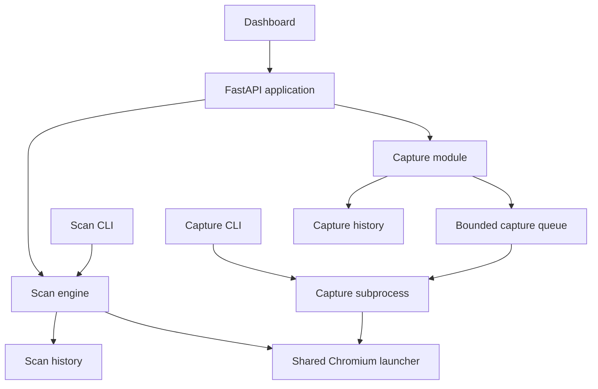

# Localghost - Developer Documentation

Setup, architecture, interfaces, and verification for working on Localghost. For an overview and the dashboard workflow, start with the [README](README.md).

**Version:** 0.1.5 | **Last Updated:** 2026-10-23
**Scope:** Shared application, scan engine, capture module, storage, interfaces, packaging, and local verification.

## Table of Contents

- [Setup](#setup)
- [Technology Stack](#technology-stack)
- [Project Structure](#project-structure)
- [Architecture Overview](#architecture-overview)
- [Configuration and Storage](#configuration-and-storage)
- [CLI](#cli)
- [Capture Module](#capture-module)
- [Login Sessions](#login-sessions)
- [API](#api)
- [Verification](#verification)
- [Troubleshooting](#troubleshooting)
- [Maintenance Notes](#maintenance-notes)

## Setup

Run commands from the inner `localghost/` directory. Python 3.12+ and uv are required. Node.js runs the frontend tests. The application itself needs no npm installation or frontend build.

```sh
uv sync --extra browser
uv run playwright install chromium
uv run localghost
```

The dashboard is served at `http://127.0.0.1:13666`. `uv run localghost --port 13667` selects another loopback port without development reload. For automatic reload while editing Python:

```sh
uv run python -m backend.main
```

`uv run uvicorn backend.main:app --host 127.0.0.1 --port 13666` is an explicit server alternative. Use one backend worker. Scan admission and capture queues are process-local; coordinate separate CLI processes when running traffic tests and use one server per database.

### Installed Packages

`uv build` creates an sdist and wheel with the dashboard, module templates, scripts,
and fonts. To install a built wheel into an activated Python environment:

```sh
uv pip install "dist/localghost-0.1.5-py3-none-any.whl[browser]"
playwright install chromium
localghost
```

`localghost --port 13666` serves the shared application on loopback. Installed
copies store databases under `$XDG_DATA_HOME/localghost`, Windows
`%LOCALAPPDATA%/localghost`, or `~/.local/share/localghost`, in that order when
available. Source checkouts retain the databases in the inner project directory.
Explicit database paths take precedence, and parent folders are created.

Run `uv run python tests/packaging_smoke.py` to build and install a wheel in a
temporary environment outside the checkout, verify bundled assets and both
commands, capture a local page, and copy its history. It uses the locked runtime
dependency versions and may download uncached wheels.

## Technology Stack

| Area | Technology |
| --- | --- |
| Runtime and packaging | Python 3.12+, uv, setuptools |
| Application and API | FastAPI, Starlette, Uvicorn, Pydantic models |
| Dashboard | Directly served HTML, CSS, and JavaScript; locally hosted Inter and Material Symbols fonts |
| HTTP work | aiohttp for scan probes; HTTPX for capture image fetching |
| Browser automation | Optional Playwright Chromium, with a shared executable launcher |
| Source and HTML parsing | Tree-sitter for source inspection; Beautiful Soup and Soup Sieve for capture extraction |
| Persistence | Separate SQLite scan and capture histories through aiosqlite |
| Verification | pytest, pytest-asyncio, Ruff, Node's test runner, Playwright, and temporary local test servers |

Dependency requirements live in `localghost/pyproject.toml`; `localghost/uv.lock` records resolved versions. The dashboard has no Node dependencies.

## Project Structure

```text
localghost/
├── assets/                     # Repository branding
├── localghost/
│   ├── backend/
│   │   ├── main.py             # FastAPI application and loopback entry point
│   │   ├── entrypoint.py       # Installed localghost server command
│   │   ├── cli.py              # Scan, export, discovery, and recheck commands
│   │   ├── middleware.py       # Local UI access and request-size checks
│   │   ├── models/             # Scan, session, finding, and report schemas
│   │   ├── routers/            # Scan, project, history, recheck, and export APIs
│   │   ├── services/           # Orchestration, source inspection, sessions, fixes
│   │   ├── scanners/           # Individual server, browser, and traffic checks
│   │   ├── database/           # SQLite history and migrations
│   │   ├── modules/xcrape/     # Capture API, lifecycle, queue, worker, extraction, history, CLI
│   │   └── utils/              # Networking, evidence, redaction, shared browser and data paths
│   ├── frontend/               # Directly served HTML, CSS, JavaScript, and fonts
│   │   └── static/xcrape/      # Capture template, styles, and behavior
│   ├── tests/                  # Python, Node, browser, and live-app checks
│   ├── pyproject.toml          # Python dependencies and tool configuration
│   ├── uv.lock                 # Resolved Python dependencies
│   └── package.json            # Node test command
├── README.md                   # User overview and quick start
├── DEVELOPMENT.md              # This guide
├── PRIVACY.md                  # Data storage, network behavior, credentials, and deletion
├── CREDITS.md                  # Font sources and third-party license notices
├── CHANGELOG.md                # Unreleased changes and version history
├── TASKS.md                    # Unfinished work
└── LICENSE.md                  # Project license
```

## Architecture Overview

FastAPI serves the shared API and frontend. Scans and Captures have separate history, execution, and network policies. They share the application shell, theme, request protections, data-path helper, and Chromium launcher. Dashboard and CLI scans share the same orchestration; standalone captures use the capture worker without creating dashboard history.



### Key Architectural Decisions

| Decision | Rationale |
| --- | --- |
| Independent capture module | Extraction, jobs, downloads, history, and compatibility remain in `backend/modules/xcrape`; scanner internals do not own capture work. |
| Separate histories | `localghost.db` contains scans and rechecks; `captures.db` contains captured page content and job state. |
| Separate network policies | Scans retain private-target validation and browser request restrictions. Captures render local or public pages and their resources. |
| Bounded capture subprocesses | Each capture has a process timeout and process-tree cleanup; queue size and concurrency are limited. |
| Isolated capture startup | Invalid capture configuration or storage leaves scanning and report history available, with capture-only 503 responses. |
| Shared browser launcher | Executable selection is shared; scanner DNS pinning and request controls remain owned by the scanner. |

### Application Startup

1. `backend.main` initializes scan history and mounts the shared routes and static frontend.
2. `modules/xcrape/lifecycle.py` loads capture settings, opens capture history, marks interrupted jobs, and starts its queue workers.
3. Capture configuration/storage errors are exposed through capture state. Scan database startup errors still prevent the host from starting.
4. Shutdown closes the capture manager and stops outstanding subprocesses. Interrupted captures can be retried after restart.

### Scan Flow

1. `models/scan.py` validates `ScanRequest`, including the target, modules, routes, environment, source folder, and optional `ScanSession`.
2. `services/scanner.py` validates and pins target addresses, prepares and verifies the session, and reads source context without executing project code.
3. Independent diagnostics and browser checks run, followed by route-level HTTP audits. These include selected server paths and up to 20 observed same-origin GET API URLs. Optional active checks run sequentially.
4. `services/findings.py` assigns stable IDs and prepares verification status, evidence, relevant files, and fix guidance. Captured credentials are redacted before the report is saved.

Browser checks visit selected pages on the target origin. Other origins and WebSockets are blocked. GET, HEAD, and OPTIONS are allowed; only explicitly configured sign-in or refresh POSTs are allowed in their respective phases. Blocked or unavailable requests leave coverage incomplete.

### Capture Flow

1. `/api/xcrape/scrape` validates an HTTP/HTTPS address and optional selector, reserves a bounded queue slot, and records a pending job.
2. A queue worker launches `backend.modules.xcrape.worker` in a separate process with the configured timeout.
3. The worker opens a fresh Chromium page, waits for bounded dynamic readiness, saves a viewport screenshot, and extracts the rendered DOM and visible content.
4. Capture history stores the result and completed/failed state. HTTP error pages can retain useful captured content with an attention message.
5. The capture view polls while visible and reads saved data. Image previews and downloads fetch the source images separately through a bounded HTTPX client.

The standalone capture command performs validation and bounded worker execution without a server or history write. Capture details, compatibility routes, configuration precedence, and import commands are documented in [Capture module](#capture-module).

### Frontend Ownership

`frontend/static/js/workspace.js` owns shared navigation and view events. The capture module loads its own static template on first entry, scopes styles and selectors to `#xcrape-view`, and renders captured strings as text or validated links. Capture shortcuts yield to shared navigation and dialogs; template mounting preserves heading focus without stealing focus after navigation or user interaction. Keep the canonical logo in `assets/localghost.svg` and its packaged copy in `frontend/static/localghost.svg` identical. The README, dashboard, and favicon use SVG.

`frontend/static/style.css` owns shared theme and layout tokens. OLED black is the default; `js/theme.js` preserves an explicitly saved light/dark preference. Captures inherit the same palette, including distinct warning, error, success, and informational colors. Page spacing responds to viewport width and height, and desktop scan sections use available columns. Keep native scrolling available for long collections, reports, code, and expanded forms; do not use page zoom or hide overflowing controls to make a layout fit.

### Findings and Rechecks

Current reports use scanner version `4` and `score: null`. Confirmed observations, review items, and incomplete checks remain separate. Generic missing-header findings have low priority and require review. TLS/DNS evidence is identified as transport/resolution evidence rather than an HTTP exchange.

Evidence comes from the actual probe and includes bounded, redacted headers and body excerpts or source file/line excerpts. Configuration diffs are reviewable suggestions; examples need adaptation to the target project. Source files are never edited automatically. Provider-shaped credentials are reported as credential material without contacting providers to validate them.

Rechecks repeat the relevant module, reload connected source context, and save separate evidence linked to the original finding. Explicitly selected traffic modules are repeated only when relevant to that finding. Missing cookies, unavailable responses, unobserved browser resources, changed scanner versions, or incomplete checks cannot establish resolution.

Comparisons require compatible scanner versions and scope, including source paths, server/browser routes, discovered audit targets, environment, session assertion profiles, session presence, and checked ports. Changed scope must not appear as a verified fix.

### Inspection Limits

| Area | Bound |
| --- | --- |
| Source traversal | 1,500 considered files and 500 folders |
| Source text | 400 files / 16 MiB total; 256 KiB per file |
| Client build output | 150 files / 32 MiB total; 2 MiB per file; 500 folders |
| Served scripts | Up to 20 same-origin scripts, 2 MiB each, per selected server route |
| Browser pages | Target page plus up to 20 additional selected paths |
| Observed API routes | Up to 20 same-origin GET API URLs |

Limits and shortened evidence do not imply full content coverage. Reaching an inspection limit makes the relevant coverage incomplete. Credential matching must remain bounded on generated JavaScript.

## Configuration and Storage

| Variable | Purpose |
| --- | --- |
| `LOCALGHOST_DB_PATH` | SQLite file; defaults to the inner project's `localghost.db` in a checkout or the installed user data directory. Parent folders are created. |
| `LOCALGHOST_CHROMIUM_PATH` | Optional Chromium executable shared by scan browser checks and captures |
| `LOCALGHOST_ALLOWED_HOSTS` | Comma-separated additional UI proxy hostnames; does not expand permitted scan targets |
| `LOCALGHOST_BROWSER` | Chromium executable used by UI test scripts |

Set variables before starting the process. In PowerShell, use `$env:LOCALGHOST_DB_PATH = 'C:/path/to/review.db'`. In a POSIX shell, use `export LOCALGHOST_DB_PATH=/path/to/review.db`.

SQLite stores report JSON in `scans`. The `rechecks` table links original scans and findings to repeat evidence, state, and timestamp. Removing either report removes its recheck link. Legacy score/grade columns remain for compatibility; new records use placeholders, and old reports remain readable without showing grades in the interface. Cookie-prefix redaction migration runs once under `PRAGMA user_version = 1`.

Capture configuration variables and `.env` precedence are listed in [Capture module](#capture-module). The optional file configures captures only; it does not set scan process variables. Both databases use the source/installed storage rules in [Installed packages](#installed-packages). Explicit modern relative database paths start at the process working directory. Read [PRIVACY.md](PRIVACY.md) before copying history or sharing captured content.

### Security Boundaries

- For scans, preserve local/private target restrictions, DNS pinning, the original Host header and TLS SNI, and server probes that do not follow redirects.
- Keep scan credentials and the credential comparison inventory in task-local memory. Do not use shared mutable session headers. Saved scan requests exclude session credentials; rechecks require them again.
- Redact scan report bodies, headers, exports, history URLs, and validation errors without altering schema enum values. Omit sign-in request bodies from evidence. Captures retain page content and screenshots without scanner redaction.
- Captures intentionally support public/local pages and ordinary page resources. Do not apply scanner request restrictions to the capture worker or share scan sessions with it.
- Treat target and source strings as untrusted. Render text or escape HTML, and retain the 64 KiB API request-body cap.
- Keep the backend on loopback. Host/Origin checks restrict browser access but do not authenticate other local programs.

## CLI

The scan CLI runs independently of the dashboard. `localghost` starts the shared server; `python -m backend.cli` runs scans, rechecks, and discovery; `python -m backend.modules.xcrape` runs standalone captures, history import, or the compatibility server. Replace the source path below with an absolute path on the machine running Localghost.

```sh
uv run python -m backend.cli scan http://localhost:3000 --source /absolute/path/to/app --environment production --browser --path /account --path /settings --format json --output report.json
uv run python -m backend.cli scan --config localghost.json --session-file /private/session.json --format html --output report.html
uv run python -m backend.cli recheck report.json FINDING_ID --session-file /private/session.json --format html --output recheck.html
uv run python -m backend.cli projects --docker
```

`--config` accepts a `ScanRequest` JSON object. Command options override corresponding settings. For example:

```json
{
  "target_url": "http://localhost:3000",
  "environment": "production",
  "paths": ["/account", "/settings"],
  "modules": {
    "browser_check": true,
    "load_test": false
  }
}
```

Unspecified modules retain their defaults. Source and browser checks are opt-in through the API/config; `--source` enables source inspection, and `--browser` enables browser checks. `--checks vuln_scan,cookie_scan,cors_scan,browser_check` replaces the entire module selection. Use `scan --help` for all options and `/docs` on the running dashboard for schemas, benchmark settings, and custom ports.

Exports support `--format text`, `json`, and standalone `html`, with finding IDs, evidence, scope, routes, and fix guidance. `--no-save` leaves local history unchanged. A recheck accepts an exported report JSON file or a saved scan ID, and requires a separate output path to preserve the original file.

| Exit | Scan | Individual recheck |
| --- | --- | --- |
| `0` | Completed with no confirmed finding at the threshold | Resolved or check completed |
| `1` | Confirmed finding meets `--fail-on` (default: `high`) | Still present |
| `2` | Incomplete checks, invalid setup, or unavailable target | Could not verify |
| `130` | Interrupted | Interrupted |

`--include-review` also fails on items needing investigation. A threshold finding takes precedence over incomplete checks in scan exit codes; both remain visible in the report. A successful exit applies only to the selected checks.

## Capture Module

Open **Captures** in the sidebar (`/#xcrape`) to save a rendered page, screenshot,
text, links, images, tables, metadata, or optional CSS selector matches. Search and
filter saved captures, capture them again, or export JSON, CSV, and images.

### Ownership and Compatibility

The `backend/modules/xcrape/` package owns extraction, its bounded process queue,
capture history, and downloads. It shares Localghost's server, Host/Origin and
request-size protections, navigation, theme, and Chromium executable setting.
Its API uses `/api/xcrape`: `POST /scrape`, `GET /jobs`, `GET`/`DELETE /jobs/{id}`,
`POST /jobs/{id}/rescrape`, and `GET /jobs/{id}/export?format=json|csv`. Image
downloads use `/jobs/{id}/images/{index}` or `/jobs/{id}/images/download-all`.
Previews pass through the same bounded downloader, with sandboxed responses.
The original `/api/scrape` and `/api/jobs/...` paths remain available as aliases,
including their string `error` responses. Host/Origin and request-size protections
apply to both namespaces. The primary `/api/xcrape` API uses the host's structured
`detail` errors.

Captures support public and local HTTP/HTTPS pages independently of scanner
target restrictions. They render JavaScript and may load external resources.
They do not run security checks, create findings, or reuse scan login sessions.
Captured content is saved as page data and can include private information.

### Capture Configuration

The configuration file is optional. To configure captures through a file, copy the repository-root [.env.example](.env.example) to `.env` and edit the copy without replacing an existing configuration. Set scan variables in the process environment separately.

| Variable | Default | Purpose |
| --- | --- | --- |
| `LOCALGHOST_CAPTURE_DB_PATH` | Source/installed data directory's `captures.db` | Separate SQLite capture history; parent folders are created |
| `XCRAPE_WORKERS` | `1` | Concurrent capture processes, from 1 to 4 |
| `XCRAPE_QUEUE_SIZE` | `20` | Waiting captures, from 1 to 100 |
| `XCRAPE_TIMEOUT` | `60` | Overall capture timeout in seconds, from 10 to 180 |
| `XCRAPE_ENV_FILE` | Repository `.env`, or launch-directory `.env` when installed | Optional capture configuration file |
| `DATABASE_URL` | Unset | Legacy SQLite file URL, used when `LOCALGHOST_CAPTURE_DB_PATH` is unset |
| `PORT` | `8000` | Port for the compatibility `xcrape` server command only |

Capture settings are loaded from the optional file and then overridden by matching
environment variables. File values remain local to the capture module and are
never injected into the host process environment. `LOCALGHOST_CAPTURE_DB_PATH`
takes precedence over `DATABASE_URL`. Legacy relative SQLite URL paths start at
the inner project directory in a checkout, or the launch directory when installed.
Both `sqlite:///` and `sqlite+aiosqlite:///` prefixes are supported.

If capture configuration or storage fails, Localghost still starts scanning and
report workflows. Capture APIs return an explained 503 response, shown in the
workspace. Fix the capture setting or storage path and restart the application.

Run one server process per database. Capture work stops when the server stops;
interrupted captures can be retried after restart. Browser support uses the same
`uv sync --extra browser` and Playwright Chromium installation as browser checks.
Without that extra, the dashboard and server checks still start, and attempted
captures explain how to install the browser support.

### Standalone Commands

The capture module also runs without starting the dashboard or scanner. From the
inner project directory:

```sh
uv run python -m backend.modules.xcrape capture https://example.com --selector article --output capture.json
uv run python -m backend.modules.xcrape import-db /absolute/path/to/scraper.db
uv run xcrape
```

The compatibility `xcrape` command starts the shared application using `PORT` or
8000. `uv run python -m backend.modules.xcrape serve --port 8000` is equivalent.
Choose Captures in its navigation. The `localghost` command defaults to 13666.

The capture command writes JSON to stdout when `--output` is omitted. Output files
must be new. It returns `0` for a completed capture, `1` for a result containing a
page error, `2` for invalid input or an unavailable worker, and `130` when interrupted.

### Importing History

To migrate history, stop both apps and run `import-db` before the first Localghost
startup that creates `captures.db`. The importer copies the source database and
refuses to overwrite the destination; startup upgrades only the copy. Use
`--destination /path/to/captures.db` and set `LOCALGHOST_CAPTURE_DB_PATH` to that
path if the default file already exists. Use an explicit `XCRAPE_ENV_FILE` to read
an existing capture configuration file from another directory.

### Capture Limits

| Area | Bound |
| --- | --- |
| Submitted address | 2,048 characters; HTTP/HTTPS without embedded credentials |
| Rendered HTML | 4 MiB |
| CSS selector | 500 characters |
| Sandboxed image preview | 32 MiB per image |
| Individual image download | 5 MiB per image |
| Image archive | Up to 50 images and 20 MiB |

Extracted collections retain truncation notes. Images that cannot be previewed have an original-image link; preview/download requests do not inherit the browser's private cookies or headers. HTTP error pages retain their captured data and appear as needing attention. JSON includes the saved viewport screenshot; spreadsheet-safe CSV includes the remaining content. Image downloads fetch the current source image.

### Capture Verification

Run the module's API, queue, extraction, migration, download, CLI, and desktop/mobile
browser regressions with `uv run pytest tests/xcrape -q`. Tests serve
temporary local pages and use isolated history. No demo applications or npm
dependencies are required.

## Login Sessions

In the dashboard, open **Options → Use a login session**. In the CLI, supply a private `ScanSession` JSON file with `--session-file`. Keep the file outside version control.

| Method | Configuration |
| --- | --- |
| Headers | Supply `cookie` and/or `authorization` header values. |
| Form sign-in | Supply a `login` object with `path`, `username`, `password`, and `success_selector`. Override field/button selectors when needed and add separate sign-in POST paths to `allowed_post_paths`. |
| Browser state | Supply `storage_state` as a JSON-encoded Playwright storage-state string containing cookies/localStorage for the selected host and origin. |

For example, a header session file:

```json
{
  "cookie": "sid=YOUR_SESSION_VALUE",
  "check_path": "/account",
  "check_selector": "[data-user-menu]"
}
```

Set `check_path` to a page requiring login. A header-only assertion requires a 2xx response; browser assertions also require the configured visible element. Choose a selector absent from the logged-out page. Supplied headers/state without an assertion are labeled unverified. Failed assertions stop authenticated HTTP checks with no anonymous fallback.

Form sign-in uses the page's own CSRF fields and same-origin redirects. `refresh_path` permits an explicit refresh POST during page checks. `authorization_storage_key` names a localStorage token to reuse as a Bearer header for later server checks. After browser pages run, asserted sessions are checked again using current cookies/storage without another sign-in. Removed cookies or tokens are cleared from server headers.

Cookie observations from initial login GETs, sign-in POSTs, authenticated pages, and refresh responses feed cookie checks. Reports retain nonsecret selectors and assertions so a recheck can repeat the scope after credentials are supplied again. External OAuth, MFA, arbitrary form workflows, and comparisons between users' permissions are outside the supported session flow.

## API

The running dashboard exposes interactive request schemas at `/docs`.

### Scan and Shared APIs

| Method | Path | Purpose |
| --- | --- | --- |
| POST | `/api/scan` | Run a scan and return the complete report |
| POST | `/api/scan/stream` | Stream NDJSON progress and the report; disconnect cancels |
| POST | `/api/projects/inspect` | Read metadata from `{ "source_path": "/absolute/path" }` |
| POST | `/api/projects/discover` | Find loopback HTTP apps on common ports |
| POST | `/api/projects/docker` | Discover local published container ports, Compose names, and source bind mounts |
| GET | `/api/projects` | Read paginated project summaries |
| GET | `/api/history` | Read paginated, searchable report summaries |
| GET / DELETE | `/api/history/{id}` | Read or delete a saved report |
| GET | `/api/history/{id}/comparison/{baseline}` | Compare compatible evidence |
| POST | `/api/history/{id}/findings/{finding_id}/recheck` | Repeat a relevant check; accepts optional `{ "session": { ... } }` |
| GET | `/api/report/{id}` | Download report JSON |
| GET | `/health` | Read liveness and app version |

Unknown scan fields are rejected. Scan routes must be paths on the selected app, with at most 20 additional paths. The desktop recommended preset includes browser checks even though the API default does not. Streaming emits `started`, `module`, `heartbeat`, `complete`, and `error` records. Scans, rechecks, and discovery share a process-local admission lock; captures use their own bounded queue.

### Capture APIs

All paths below use the `/api/xcrape` prefix. Capture addresses must be HTTP/HTTPS, at most 2,048 characters, and contain no embedded username/password.

| Method | Path | Purpose |
| --- | --- | --- |
| POST | `/scrape` | Queue `{ "url": "https://example.com", "selector": "article" }`; return 202 and a `job_id` |
| GET | `/jobs` | Search/filter history with `page`, `page_size` (up to 50), `q`, and `status` |
| GET / DELETE | `/jobs/{id}` | Read or delete a capture; deleting also cancels associated work |
| POST | `/jobs/{id}/rescrape` | Queue another capture with the saved address and selector |
| GET | `/jobs/{id}/export?format=json` | Export saved JSON; `format=csv` exports content without screenshot data |
| GET | `/jobs/{id}/images/{index}/preview` | Fetch a bounded, sandboxed inline image preview |
| GET | `/jobs/{id}/images/{index}` | Fetch an individual source image for download |
| GET | `/jobs/{id}/images/download-all` | Fetch source images into a bounded ZIP archive |

Job statuses are `pending`, `running`, `completed`, and `failed`. A full queue returns 429 with `Retry-After: 5`; capture startup failures return 503. The primary API returns `detail` errors, while the legacy `/api/scrape` and `/api/jobs/...` aliases preserve string `error` responses. Those aliases are excluded from OpenAPI. Host/Origin and request-size protections apply to both namespaces.

## Verification

Choose checks relevant to the change. Backend tests can be narrowed by file or test name; browser and Docker checks are separate acceptance runs.

```sh
uv run ruff check backend tests main.py
uv run pytest -q tests/test_product_completion.py
npm test
```

For the full backend suite, use `uv run pytest -q`. Browser-dependent tests require the Playwright Chromium installation from setup.

### Browser and Live-App Checks

```sh
uv run python tests/product_browser.py --output ../../localghost-artifacts/product
uv run python tests/capture_screenshots.py --output ../../localghost-artifacts/screenshots
```

| Script or test | Coverage and requirements |
| --- | --- |
| `tests/test_product_completion.py` | Configuration parsing, routes, evidence, credentials, sessions, Docker hints, CLI rechecks, redaction, and generated-JavaScript matching |
| `tests/test_product_workflow.py` | Loopback servers and Chromium, source context, credential handling, browser errors, CLI exits, and before/after rechecks |
| `tests/product_browser.py` | Desktop source selection, sessions, evidence, fixes, and optional axe checks via `--axe` |
| `tests/capture_screenshots.py` | Screenshots and PDF output using temporary history and identified fixtures |
| `tests/xcrape/` | Capture API, database, queue, extraction, settings, history import, CLI, downloads, and desktop/mobile UI |
| `tests/packaging_smoke.py` | Builds and installs a temporary wheel outside the checkout; verifies bundled assets, commands, a capture worker, exports, data paths, and history copy |
| `tests/browser_smoke.py` | Navigation, reports, history, themes, and keyboard behavior; writes screenshots under `/tmp`, so use a Linux environment |
| `tests/live_review.py` | Vulnerable/fixed control servers and optional external training apps; requires a running Localghost API and `--api-url`, `--output`; optional axe via `--axe-path` |
| `tests/authenticated_apps.py` | Sessions on already initialized, disposable Juice Shop/DVWA apps; does not initialize or reset DVWA |

`live_review.py` can initialize/reset the disposable DVWA database when given `--dvwa-url`. Its direct SQL-injection and script-execution controls are separate from Localghost's scanner coverage.

### Docker Acceptance

`completion_browser.py` requires a Linux Docker socket at `/var/run/docker.sock` and an already available image with Node. It does not pull an image. Run it from a Linux environment with access to that socket:

```sh
uv run python tests/completion_browser.py --image node:22-bookworm-slim --output ../../localghost-artifacts/docker
```

Use `--node-executable` for an image with a nonstandard Node path and `--axe` to supply axe-core. The script creates and removes its own Compose fixture, publishes ports on loopback, mounts source read-only, and uses temporary history. It checks discovery, source binding, form sign-in, GET API coverage, evidence, rechecks, and themes.

Keep generated evidence outside the repository, as in the output paths above. Do not commit databases, session files, private keys, or bytecode. Track unfinished work in [TASKS.md](TASKS.md), and update the [changelog](CHANGELOG.md) for verified user-visible changes.

## Troubleshooting

| Symptom | What to check |
| --- | --- |
| Browser check or capture worker is unavailable | Install the `browser` extra and Playwright Chromium, or set `LOCALGHOST_CHROMIUM_PATH` to a valid executable. UI test scripts use `LOCALGHOST_BROWSER`. |
| Source folder is unavailable | Use an absolute path accessible to the Localghost process. Docker bind-mount suggestions must exist on that machine. |
| Docker app is missing or unreachable | Start the local daemon, check CLI/socket access, and publish the web port. Confirm the HTTP/HTTPS scheme. An unpublished container port cannot be reached through localhost. |
| Production mode remains unknown | Run the production build locally. A selected mode alone is insufficient; served content must provide supporting evidence. |
| Authenticated checks stop | Check the session, asserted page, and visible selector. Supply credentials again for rechecks. |
| Scan history cannot be saved | Check `LOCALGHOST_DB_PATH` and write access to its parent. Missing parent folders are created automatically. |
| Captures shows unavailable / API returns 503 | Read the displayed setup error; check capture settings, database file type, and write access. Fix the issue and restart Localghost. Scans can remain available. |
| Capture is interrupted or takes too long | Restarted jobs are marked failed; retry from history. Check the page and the bounded `XCRAPE_TIMEOUT` setting. |
| Capture queue is full / API returns 429 | Wait for pending work to finish. Adjust `XCRAPE_QUEUE_SIZE` or `XCRAPE_WORKERS` only within their documented bounds. |
| Image preview works but download is rejected | Previews allow 32 MiB; downloads allow 5 MiB per image. Both fetch the source again and do not share browser cookies. |
| History import refuses a destination | The importer never overwrites an existing file. Choose a new `--destination`, set `LOCALGHOST_CAPTURE_DB_PATH` to it, and restart. |
| Workload is busy | Wait for the current scan or discovery run. Use one backend worker and coordinate CLI traffic tests. |

When running Localghost in a container yourself, mount the source and use a private target address reachable from that container. Localghost container packaging is not currently provided.

## Maintenance Notes

- Keep project guides and repository artwork at the root. Keep application source, dependency manifests, environment, and tests inside `localghost/`. Run application commands from that directory.
- Keep the README focused on installation and the two user workflows. Keep implementation and command references here, and update [PRIVACY.md](PRIVACY.md) whenever network, storage, authentication, export, or deletion behavior changes.
- Update the package description, API description, and dashboard wording together when the product's purpose changes. The package version is authoritative; keep the API, health response, and visible version aligned without bumping versions during unrelated work.
- Keep scan network/authentication rules separate from capture behavior. Module-specific startup failures should remain isolated, and neither history should silently replace the other.
- Run focused checks for the affected area. Packaging changes require verifying bundled frontend assets and writable installed data paths; capture/browser changes require relevant Chromium checks. Do not present past test counts as a fresh verification run.
- Keep `assets/localghost.svg` and `localghost/frontend/static/localghost.svg` identical. Use SVG in the README, application, and favicon; retain original artwork under `-old` names.
- Record unfinished, evidence-backed tasks in [TASKS.md](TASKS.md). Update only the current unreleased changelog for completed user-visible behavior, and preserve historical entries. Release notes and version changes require an explicit request.

---

[Back to README](README.md)
